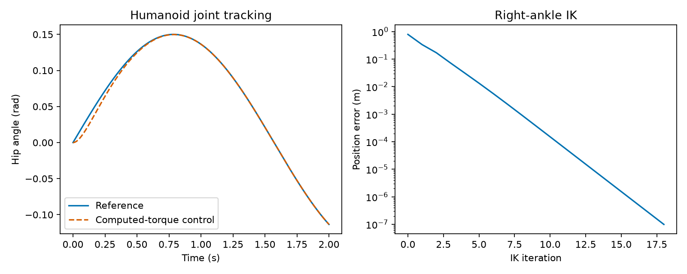

# Bipedal Robot Kinematic Chain Simulator

A humanoid kinematics and joint-control application extending [Pinocchio](https://github.com/stack-of-tasks/pinocchio). The upstream library and its author credits are preserved; application additions live in `portfolio/`.



## Features

- Deterministic humanoid rigid-body tree with a fixed pelvis and 28 joint degrees of freedom.
- Damped-Jacobian right-ankle position inverse kinematics.
- Computed-torque tracking using recursive Newton–Euler inverse dynamics and articulated-body forward dynamics.
- CSV trajectories and joint torques, JSON measurements and a headless report plot.
- Checks for positive-definite inertia, gravity balance and inverse/forward dynamics agreement.

This is a fixed-pelvis joint-motion experiment. Ground contact, walking balance, physical test benches, ROS 2 integration and PyTorch training are outside the current application. The runnable stack is Python, NumPy, Matplotlib and Pinocchio's C++ engine.

## Run

Tested with Python 3.12 on Ubuntu under WSL. Install `libgomp1` if requested by the native runtime. Native Windows wheels were unavailable in the tested installation path.

```bash
python3 -m venv .venv
source .venv/bin/activate
python -m pip install -r portfolio/requirements.lock
python -m portfolio.biped
python -m pytest portfolio -q
```

Use `--output path/to/results` for a separate run. Default outputs are in `portfolio/results/`. Timings measure warmed single-call latency and are machine-specific.

## Results and requirements

Generated [metrics](portfolio/results/metrics.json), [trajectory](portfolio/results/trajectory.csv) and [verification](doc/PROJECT_VERIFICATION.md) describe the tested experiment. [Project requirements](doc/PROJECT_REQUIREMENTS.md) retain the exact requested improvement figures as acceptance targets, separately from actual measured results.

## Origin and license

Derived from `stack-of-tasks/pinocchio` at `501dec51bf5d0096b69952a7d27e3fba40f1c72e`. Original copyrights and [BSD-2-Clause license](LICENSE) remain intact. Application additions were prepared for Shivam Sharma with Codex assistance. The [upstream README](doc/UPSTREAM_README.md) contains the original library documentation.
